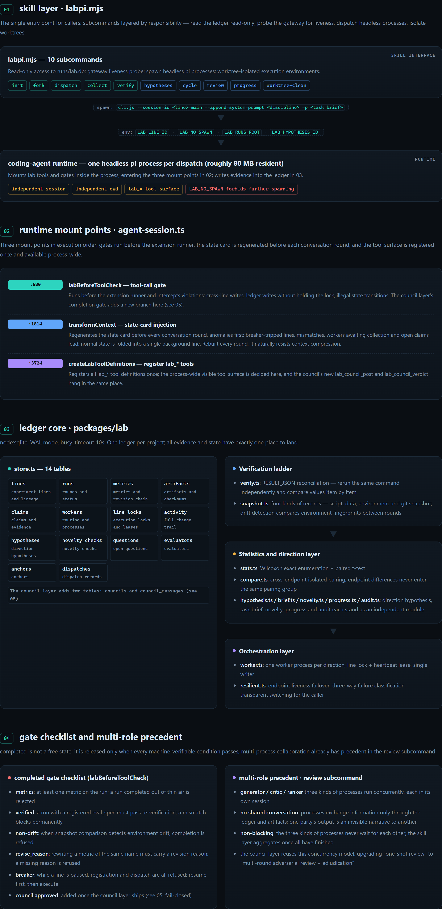
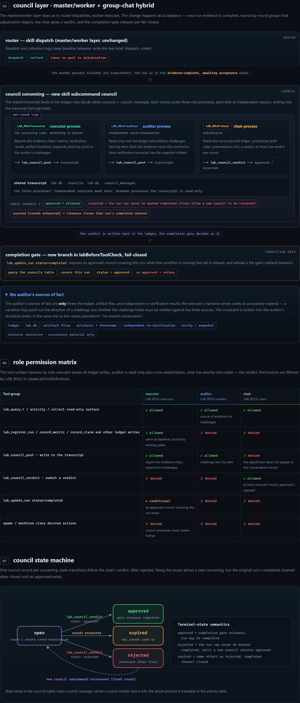

<p align="center">
  <a href="https://github.com/qimingfan10/LabPi">
    
  </a>
</p>
<p align="center">
  <a href="https://github.com/badlogic/pi-mono"></a>
  <a href="https://github.com/deepseek-ai/dsh-superagent-prototype"></a>
  <a href="https://www.npmjs.com/package/@earendil-works/pi-coding-agent"></a>
</p>

# LabPi — a research superagent, built on pi

**LabPi turns [pi](https://github.com/badlogic/pi-mono) — one of the most starred open-source coding agents — into a research-experiment superagent.** It follows the router/worker orchestration ideas DeepSeek open-sourced in [dsh-superagent-prototype](https://github.com/deepseek-ai/dsh-superagent-prototype), but instead of managing code repositories, LabPi manages **experiments**: every run has a ledger entry, every conclusion carries evidence, parallel directions get their own isolated worker processes, and "it works" is something a statistical test has to sign off on.

> A research-grade superagent: the router/worker orchestration ideas of DeepSeek's dsh-superagent prototype, implemented on top of the pi kernel — parallel orchestration of multiple experiment directions, conclusions that must carry evidence, and claims written down so they can be overturned.

## The problem it solves

AI researchers don't lose experiments to weak models. They lose them to the chaos around the model: three experiment directions run in one context and pollute each other, results end up scattered across chat logs and temp folders, a judge silently scores failures as zeros and a wrong conclusion survives for weeks, endpoint flakiness invalidates an overnight run, and "v5 is better than v4" is never tied to a significance test.

These are not tooling gaps. They are **discipline gaps** — and discipline cannot be installed as a plugin. LabPi builds it into the agent loop itself.

## The mechanisms

| Mechanism | Where it lives | What it enforces |
| --- | --- | --- |
| **Experiment ledger** | `packages/lab` (new package, node:sqlite) | Five ledgers — lines, runs, metrics, artifacts, claims. Every run gets a directory with config fingerprint, logs and per-scenario results; every metric carries model, endpoint and measurement conditions |
| **Completion gate** | `agent-session.ts` beforeToolCall, ahead of the extension runner | A run cannot be marked `completed` without recorded metrics. The model is blocked at the loop level and must either record evidence or honestly file a failure with a class |
| **Evidence-linked claims** | ledger + comparison tools | Conclusions are registered with evidence references and optional direction assertions; every comparison auto-verifies direction and reports conflicts; a refuted claim loses its license to be cited as fact |
| **Independent verification** | `lab_verify_run` + per-run eval spec | The evaluator re-runs the registered evaluation command and compares the script's own `RESULT_JSON` against the ledger. A mismatch blocks completion — the executor never signs off on its own numbers |
| **Router/worker orchestration** | `lab_worker_spawn / status / collect` | One headless pi worker process per experiment direction, bound to one line, ledger writes locked to it (single-writer). The router spawns and collects, never executes; concurrency has no built-in cap (caller may throttle via maxWorkers); blocked workers wait for the router |
| **Group-chat adversarial review** | `lab_council_open / post / read / verdict` + `council` skill subcommand | Before a run counts as done, executor, auditor and chair cross-examine in a shared transcript: the executor reports on the task brief, the auditor — read-only over the ledger and artifacts — challenges item by item, flagging verdict-invalidating defects with `severity=blocking`, and the chair adjudicates. A blocking challenge is a lifetime latch within that council — `approved` requires zero outstanding and constraint-qualified approval is refused at the ledger and tool layers. The completion gate requires an `approved` council covering the run; rejected/expired fail closed |

On top of these: resilient LLM calls with endpoint failover and three-way failure classification (infra / format / semantic — silence is not an option), exact Wilcoxon and paired-t statistics validated against reference values, task pools with measured difficulty metadata and bidirectional band filtering, Python evaluation scripts as subprocesses with hard timeouts.

**Verification ladder.** Deterministic evidence first, judgement last: the evaluation script's own structured output → a structured comparison against the ledger (tolerance-bounded) → a paired significance test → a claim. Anything a machine can check is never handed to an LLM to judge, and the reported number is never trusted merely because the worker said so. A run backed by a script cannot be completed before `lab_verify_run` passes; a run without one can only complete as an explicitly declared `manual` evidence class, permanently stamped `unverified` in the ledger.

**Governance over agent goodwill.** Ledger entries are append-only: correcting a metric demands a stated reason and keeps the old value as history. Three consecutive failed runs on one line trip the breaker and pause it until someone records what was investigated. Each line carries a lease (execution lock): one writer at a time, renewed on every write, stealable after the holder dies; a unified activity log (`lab_activity`) records every mutation — status changes, metric revisions, verifications, lock transfers, breaker trips. Every evaluation keeps an input snapshot (script copy plus data, environment and git fingerprints), so when the code has moved on the ledger can still answer what actually ran — and a changed script is reported as drift, not as fabricated numbers. The state card shows anomalies only — paused lines, failed verifications, workers awaiting collection, open claims — so normal operation stays in the background.

## Group-chat review architecture

The current architecture and the router + group-chat hybrid it extends:



The council layer: executor, auditor and chair processes share one ledger-backed transcript; a blocking finding latches for the whole session, and the chair's verdict gates completion.



[Full interactive diagram](docs/council-architecture.html)

## What it looks like

```
you> Create experiment line baseline, register a run (stage=eval, model sevo_v4)
     ... run evaluation ...
you> Record total_score=3.69 with per-scenario scores, mark the run completed
you> Fork three direction lines from baseline and spawn a worker for each:
       recipe-a: pure empathy corpus    recipe-b: warmth-first corpus
       recipe-c: 6:4 mixed ratio
you> (keep working — workers run in their own processes and sessions)
you> /workers                          # router view
you> Collect all workers and compare the three lines with paired tests
    → conflicts with open claims are reported automatically
you> Register claim: recipe-c wins, evidence = W3 report + paired test
```

A worker that tried to write another line's ledger was **rejected at the loop level** — the single-writer guarantee is not a prompt, it is the tool interface. A model asked to mark an empty run `completed` was blocked and chose to file an honest `failed` instead.

## Quick start

Requires Node.js ≥ 22.19.

```bash
git clone https://github.com/qimingfan10/LabPi.git
cd LabPi
npm install --ignore-scripts
npm run build
./pi-test.bat --provider <your-provider> --model <your-model>
```

Model endpoints are configured in `~/.pi/agent/models.json` (any OpenAI-compatible endpoint works, including vLLM). Evaluation scripts run via `lab_eval_run_python` — Python is auto-detected (`python` / `py` / `python3`).

Everything pi can do, LabPi can do: file tools, session trees, compaction, forks, extensions, MCP — plus the mechanisms above, which are part of the kernel, not plugins.

## Relationship to upstream

- **[pi](https://github.com/badlogic/pi-mono)** by Mario Zechner (earendil-works): the agent kernel — loop, tool execution, providers, TUI, session trees. LabPi is a distribution of it. `origin` points upstream; follow it with `git merge`.
- **[dsh-superagent-prototype](https://github.com/deepseek-ai/dsh-superagent-prototype)** by DeepSeek: the source of the router/worker orchestration ideas (work-item isolation, single-writer state, worker slots, waits-for-person). LabPi applies them to research experiments with LLM-judged, statistics-verified outcomes. dsh is a research prototype marked "not an official DeepSeek product"; LabPi is likewise an independent implementation and is not affiliated with or endorsed by DeepSeek.

The lab changes live in the `lab/main` branch and touch one new package plus seven kernel files — the full diff is the answer to "what does a research harness actually add to an agent kernel".

## License

MIT, same as both parents of the ideas in this repository.
